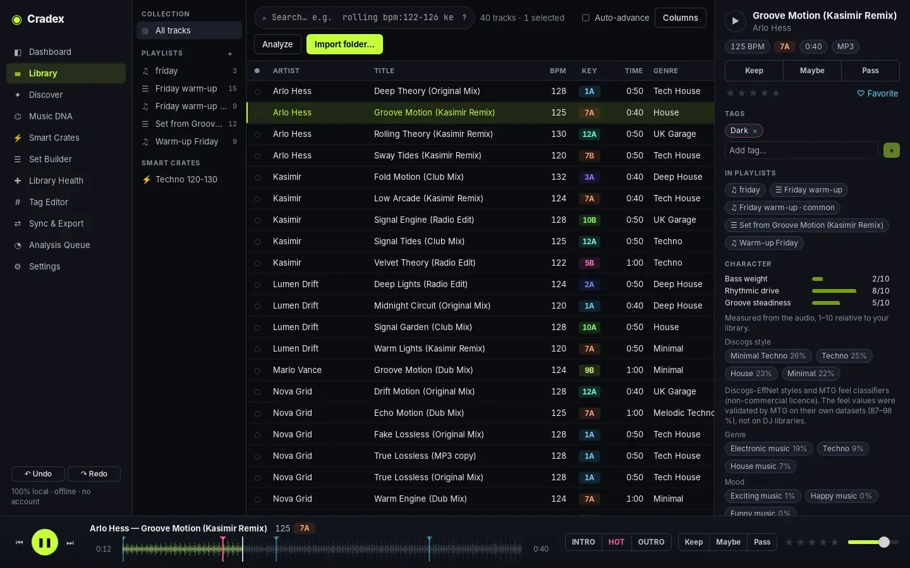
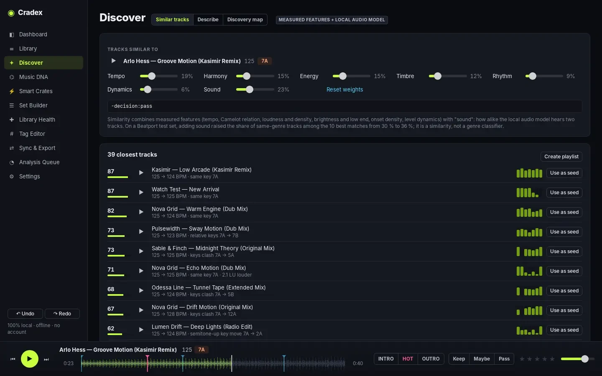
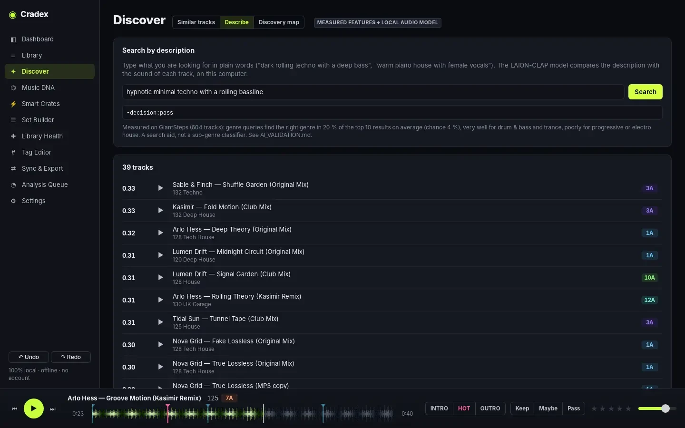
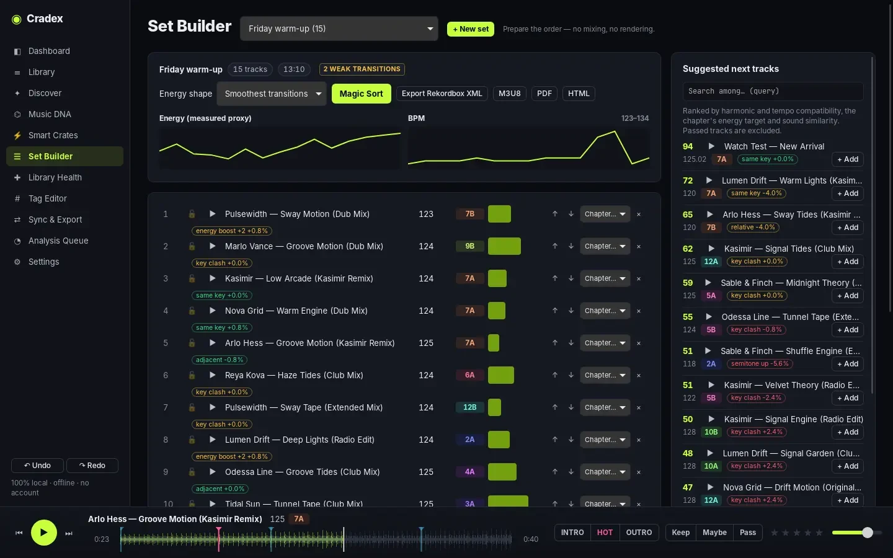
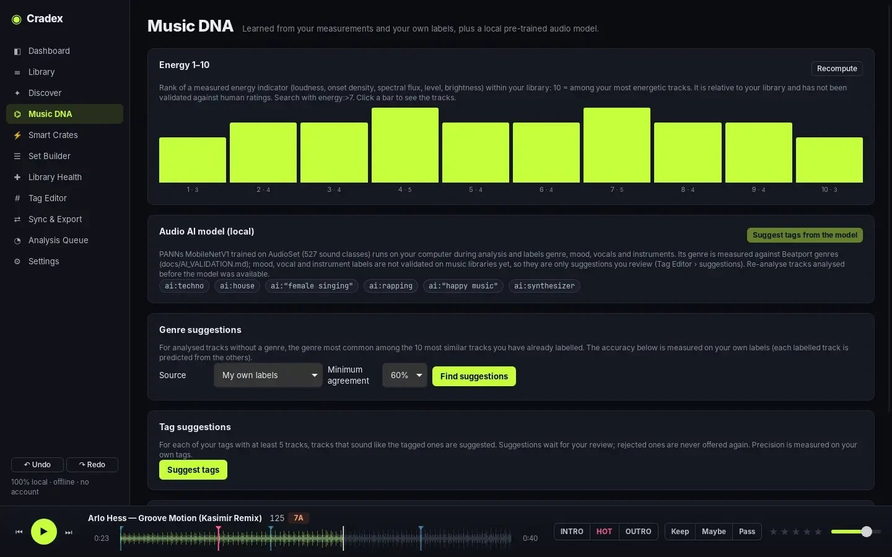

<div align="center">


# Deep Cuts

**Your DJ library, finally in order.**<br>
Analyse, triage, organise and export your music on your own computer.<br>
Free · Open source · Offline · No account

[](https://github.com/Nicodesy06/Deep-Cuts/releases)
[](LICENSE)
[](https://nicodesy06.github.io/Deep-Cuts/#download)
[](https://github.com/Nicodesy06/Deep-Cuts/actions/workflows/ci.yml)

**[Website](https://nicodesy06.github.io/Deep-Cuts/)** &nbsp;·&nbsp; **[Download](https://nicodesy06.github.io/Deep-Cuts/#download)** &nbsp;·&nbsp; **[Guide](https://nicodesy06.github.io/Deep-Cuts/guide.html)** &nbsp;·&nbsp; **[Measured results](docs/AI_VALIDATION.md)**

<br>



</div>

<br>

## Why Deep Cuts

| | |
|---|---|
| **Private by design** | Analysis, AI models and search run on your machine. No account, no telemetry, nothing uploaded. |
| **Measured, not promised** | Every analysis and AI feature is tested on public benchmarks before it ships, and the numbers are published, weak spots included. |
| **Speaks your DJ software** | Rekordbox XML, Traktor NML, Serato crates and VirtualDJ, in and out, with BPM, key, cues, loops and beatgrids; round-trip tested per format, checks inside each application in progress. |
| **Your files stay untouched** | Imports are read-only; tags are written only on request, to a verified copy; file moves are journalled and recovered after a crash; nothing is deleted, everything can be undone. |
| **Fast on big libraries** | Built for 100,000+ tracks: the first page opens in 40 ms, searches take 1–120 ms. |
| **Free and open** | GPL-3.0, no paid tier, an open SQLite library and a command-line tool on the same data. |

## A look inside

<table>
  <tr>
    <td width="50%"><br><b>Discover</b> — similar tracks by measured features and sound, with harmonic and tempo notes.</td>
    <td width="50%"><br><b>Search by description</b> — “hypnotic minimal techno with a rolling bassline”, matched on your computer (optional LAION-CLAP model).</td>
  </tr>
  <tr>
    <td width="50%"><br><b>Set Builder</b> — energy shapes, weak transitions, chapters and next-track suggestions.</td>
    <td width="50%"><br><b>Music DNA</b> — energy 1–10 in your library, local audio model, suggestions learned from your labels.</td>
  </tr>
</table>

## Measured

| Result | What it measures | Test set |
|---:|---|---|
| **92.5 %** | BPM within 4 % (98.0 % counting half/double tempo; 86.9 % within 0.05 BPM) | Beatport-labelled tracks, held-out half (550) |
| **67.5 %** | Key, MIREX weighted score (59.3 % exactly right) | GiantSteps Key (604) |
| **61 %** | Optional MAEST styles, right genre first (88 % in the top three) | GiantSteps Key subset (143) |
| **42 %** | Optional Discogs-EffNet styles, right genre first (75 % in the top three) | GiantSteps Key (565) |
| **20 %** | Search by description, right genre in the top 10 (chance 4 %) | GiantSteps Key (604) |

Protocol, per-genre results and what was evaluated but not adopted: [docs/AI_VALIDATION.md](docs/AI_VALIDATION.md).

## Download

Get the installer for **macOS** (Apple silicon or Intel), **Windows** or **Linux** (`.deb`, AppImage) from the
[website](https://nicodesy06.github.io/Deep-Cuts/#download) or the [releases page](https://github.com/Nicodesy06/Deep-Cuts/releases).
Installers are not code-signed yet; the [guide](https://nicodesy06.github.io/Deep-Cuts/guide.html#install) shows the one extra click.

<details>
<summary><b>Everything it does today</b></summary>

<br>

* **Import** folders (recursive, drag-and-drop or dialog): MP3, WAV, AIFF, FLAC, ALAC/AAC (M4A), OGG.
  Import is read-only and incremental. Moved files are relinked by content.
* **Library** with a virtualised table (100k+ tracks), sortable/custom columns, multi-select,
  context menu, playlists, and a details inspector that shows where every value came from
  (file / Rekordbox / analysis / you). Single and bulk editing; any edit can be reverted.
* **Keep / Pass / Maybe** triage with keyboard shortcuts (`K` `P` `M` `U`, ratings `1`–`5`,
  auto-advance) and contextual decisions.
* **Preview player**: waveform, seek, HOT preview (measured most-energetic region), intro/outro,
  next/previous. Decoded fallback for formats the webview can't play.
* **Local audio analysis** (pure DSP, background queue that survives restarts): BPM, beat phase, key
  (Camelot/Open Key), EBU R128 loudness, peak/crest, spectral brightness and low end, onset rate,
  energy curve, waveform.
* **Search language** shared with **Smart Crates**:
  `rolling bpm:122-126 key:8A+ genre:"tech house" -decision:pass (label:a OR label:b)`.
* **Library Health**: missing files, duplicates (identical files, same artist + title, same recording
  by acoustic fingerprint across formats), fake-lossless/transcode suspects, playlists with missing
  files, unused files. **Merge duplicates** keeps one copy, re-points playlists and moves the others
  to a trash folder. Nothing is ever deleted.
* **DJ software**: import and export **Rekordbox XML**, **Traktor NML**, **Serato crates** and
  **VirtualDJ** (tracks, playlists and folders, BPM, key, rating, comments, cues, loops, beatgrid
  where the format has them); **M3U8** and **CSV** export.
* **Rebuild external playlists offline**: Spotify (Exportify CSV), Apple Music text exports, M3U or
  "Artist - Title" tracklists matched to your files, with review and a missing-tracks list.
* **Music DNA**: energy 1–10 within your library, genre and tag suggestions learned from your own
  labels (with measured accuracy), automatic groups; **Discover** (similar tracks, map);
  **Set Builder** (chapters, Magic Sort, next-track suggestions, build a set from one track).
* **Bulk tools**: find & replace (regex), CSV metadata import with column mapping, rename/move files
  from metadata, playlist merge/common/subtract/shuffle/prefix, archive, cover art add/remove,
  relocate the library to another drive, **recipes** (saved search + actions, also on import).
* **Undo / redo** (Ctrl/⌘+Z) for edits, decisions, tags and smart fixes, plus per-track change history.
* **Tags**: hierarchical tags, synonyms, categories, Quick Tag (Shift+1…9), Tag Editor.
* **Smart Fixes** with preview: URLs/promo text, track-number prefixes, SHOUTED CAPS, feat./separators,
  genre spelling, invisible characters, version/remixer extraction.
* **Cue points, loops, beatgrid**: phrase-aligned cue suggestions (Intro/Main/Breakdown/Drop/Outro),
  memory/hot cues at the playhead (`C`), beat-snapped loops, beatgrid editor with tap tempo.
* **Write tags to files** on request (dry run, copies of originals, read-back verification).
* **Watch folders** for automatic import.
* **Backups**: daily automatic snapshot, manual backups, automatic snapshot before risky operations,
  restore with safety copy, integrity check.
* **Dashboard** computed from your real library. **English and Italian** UI.
* `deepcuts` **CLI** on the same database (import, search, decide, analyze, tag, fix, write-tags, rename, import-dj, export-dj, match-playlist, undo, export, stats, eval, bench).

</details>

## Build and run

Requirements: Rust (stable), Node.js 22. On Linux, also the Tauri system packages
(`libwebkit2gtk-4.1-dev librsvg2-dev`).

```bash
npm install          # also installs ui/ dependencies
npm run dev          # desktop app with hot reload
npm run build        # installers in target/release/bundle (MSI/NSIS, DMG, deb/AppImage)
npm test             # UI unit tests + all Rust tests
cargo run -p dc-cli --release -- --help    # CLI
```

The library lives in the OS data directory (`%APPDATA%\DeepCuts`, `~/Library/Application Support/DeepCuts`,
`~/.local/share/DeepCuts`). Set `DEEPCUTS_HOME` to use another location.

## Repository layout

```
crates/dc-core   Rust core: database, import/export, provenance, analysis, models, jobs, backups
crates/dc-cli    `deepcuts` command-line tool
src-tauri        desktop shell (IPC commands, audio protocol)
ui               React + TypeScript interface
site             website (landing page and guide, published with GitHub Pages)
docs             architecture, feature matrix, test plan, benchmarks, licensing, status
```

## Documentation

* [Status report](docs/STATUS.md) · [Feature audit](docs/FEATURE_AUDIT.md) · [Competitor feature matrix](docs/COMPETITOR_FEATURE_MATRIX.md)
* [Architecture & database](docs/ARCHITECTURE.md) · [Scope](docs/SCOPE.md)
* [Test plan](docs/TEST_PLAN.md) · [Analysis/AI validation](docs/AI_VALIDATION.md) · [Benchmarks](docs/BENCHMARKS.md)
* [Audit response](docs/AUDIT_RESPONSE.md) · [Release checklist](docs/RELEASE_CHECKLIST.md)
* [Licensing](docs/LICENSING.md) · [Model research](docs/MODEL_RESEARCH.md) · [Legacy migration](docs/LEGACY_MIGRATION.md)

## Licence

GPL-3.0-or-later. See [`LICENSE`](LICENSE) and [`docs/LICENSING.md`](docs/LICENSING.md) for the bundled and optional models.
Rekordbox, Traktor, Serato and VirtualDJ are trademarks of their owners; Deep Cuts is not affiliated with them.
